# Informe – Laboratorio 5.2: Pipeline de Despliegue Continuo con Docker

**Estudiante:** Jaldin Gonzales Walter


**Docente:** Ing. Lucio Marcelo Quispe


**Materia:** Trabajando en la Nube (COM610)


**Fecha:** 18 de noviembre de 2026


| Entregable                        | Enlace                                                                                                               |
| --------------------------------- | -------------------------------------------------------------------------------------------------------------------- |
| Repositorio                       | [https://github.com/walterjaldin/cd-productos-api](https://github.com/walterjaldin/cd-productos-api)                 |
| API en **production** (puerto 80) | [http://32.199.159.225/health](http://32.199.159.225/health)                                                         |
| API en **staging** (puerto 8080)  | [http://32.199.159.225:8080/health](http://32.199.159.225:8080/health)                                               |
| Imagen en Docker Hub              | [https://hub.docker.com/r/walterjaldin/cd-productos-api](https://hub.docker.com/r/walterjaldin/cd-productos-api)     |
| Pipeline (Actions)                | [https://github.com/walterjaldin/cd-productos-api/actions](https://github.com/walterjaldin/cd-productos-api/actions) |


---

## 1. Descripción general

Se tomó la API CRUD de productos del Laboratorio 5.1 (Node.js 22 + Express 5, Jest + Supertest, ESLint) y se le añadió un **pipeline completo de CI/CD con contenedores**:

```
 git push (main / tag v*)
        │
        ▼
 ┌──────────────┐   ┌────────────────────────┐   ┌──────────────────┐   ┌───────────────────────┐
 │ Lint y       │──►│ Build, scan y push     │──►│ Deploy a staging │──►│ Deploy a production   │
 │ pruebas      │   │ multi-stage + Scout    │   │ (automático)     │   │ (requiere aprobación) │
 └──────────────┘   │ → Docker Hub (SHA,     │   │ EC2 :8080        │   │ EC2 :80               │
                    │   semver, latest)      │   └──────────────────┘   └───────────────────────┘
                    └────────────────────────┘
                                        Rollback manual (workflow_dispatch) ──► staging / production
```


| Componente        | Detalle                                                                                    |
| ----------------- | ------------------------------------------------------------------------------------------ |
| Aplicación        | `src/app.js` (rutas), `src/productos.service.js` (lógica), `src/server.js` (arranque)      |
| Endpoint de salud | `GET /health` → `{ status, version, entorno, commit }`                                     |
| Imagen            | `walterjaldin/cd-productos-api` en Docker Hub                                              |
| Servidor          | EC2 `t3.micro` Ubuntu 24.04 (`lab52-cd-server`, us-east-1), Docker 29.10                   |
| Entornos          | `staging` → contenedor `cd-api-staging` en `:8080` · `production` → `cd-api-prod` en `:80` |
| Workflows         | `.github/workflows/cd.yml` (pipeline) · `.github/workflows/rollback.yml` (rollback)        |
| Script de deploy  | `scripts/deploy.sh` (health check + reemplazo + rollback automático)                       |


`/health` devuelve versión, entorno y commit. Así se puede comprobar desde fuera qué versión está corriendo en cada entorno. 

---

## 2. Dockerfile multi-stage y prueba local

### 2.1 Dockerfile

```dockerfile
# ---------- Etapa 1: dependencias + verificacion ----------
FROM node:22-alpine AS builder
WORKDIR /app
COPY package*.json ./
RUN npm ci
COPY . .
RUN npm run lint && npm test

# ---------- Etapa 2: dependencias de produccion ----------
FROM node:22-alpine AS prod-deps
WORKDIR /app
COPY package*.json ./
RUN npm ci --omit=dev && npm cache clean --force

# ---------- Etapa 3: runtime minimo ----------
FROM node:22-alpine AS runtime
ARG APP_VERSION=1.0.0
ARG GIT_SHA=dev
ENV NODE_ENV=production PORT=3000 APP_VERSION=${APP_VERSION} GIT_SHA=${GIT_SHA}
# Hardening: parches del SO y eliminar npm/yarn/corepack (no se usan en runtime)
RUN apk upgrade --no-cache \
 && rm -rf /usr/local/lib/node_modules/npm /usr/local/lib/node_modules/corepack \
           /usr/local/bin/npm /usr/local/bin/npx /usr/local/bin/corepack \
           /opt/yarn-* /usr/local/bin/yarn /usr/local/bin/yarnpkg
WORKDIR /app
COPY --from=prod-deps --chown=node:node /app/node_modules ./node_modules
COPY --from=builder   --chown=node:node /app/package.json ./
COPY --from=builder   --chown=node:node /app/src ./src
USER node
EXPOSE 3000
HEALTHCHECK --interval=15s --timeout=3s --start-period=5s --retries=3 \
  CMD wget -qO- http://localhost:3000/health || exit 1
CMD ["node", "src/server.js"]
```


- **Tres etapas en lugar de dos.**
  - `builder` instala *todas* las dependencias y ejecuta **lint y tests dentro del build**. Si fallan, la imagen no se genera.
  - `prod-deps` instala solo las dependencias de producción (`--omit=dev`). Jest, ESLint y Supertest nunca llegan a la imagen final.
  - `runtime` copia únicamente `node_modules` de producción, `package.json` y `src/`.
- **Usuario sin privilegios (`USER node`).** Docker Scout lo valida con la política *Default non-root user* ✓.
- **`HEALTHCHECK` dentro de la imagen.** Docker marca el contenedor como `healthy` o `unhealthy`; se ve en `docker ps`.
- **`APP_VERSION` y `GIT_SHA` como build-args.** Así cada imagen sabe qué versión y commit contiene.

`.dockerignore` excluye `node_modules`, `coverage`, `.git`, `.github`, `.env`, `img`, `*.md`, `scripts` y el propio Dockerfile. Así el contexto de build pesa solo unos cientos de bytes.

### 2.2 Build local

```bash
docker build -t cd-productos-api:local --build-arg APP_VERSION=1.0.0 --build-arg GIT_SHA=local .
```

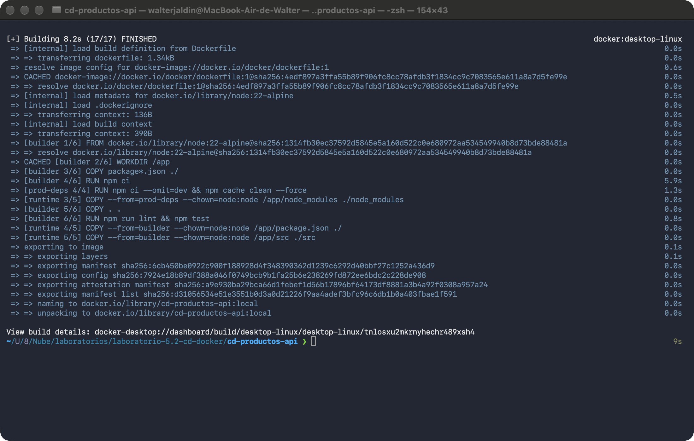

Se observan las tres etapas (`builder`, `prod-deps`, `runtime`). El paso `[builder 6/6] RUN npm run lint && npm test` corre dentro del build.

### 2.3 Prueba del contenedor

```bash
docker run -d -p 3000:3000 -e APP_ENV=local --name app-local cd-productos-api:local
curl http://localhost:3000/health
docker stop app-local && docker rm app-local
```

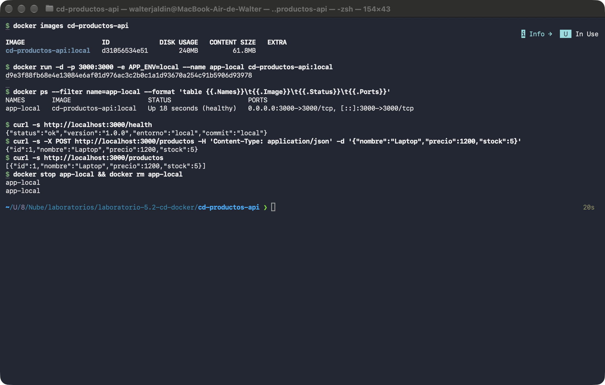

El contenedor aparece como **`(healthy)`**, `/health` responde `{"status":"ok",...}` y el CRUD funciona. El tamaño de contenido de la imagen es **61.8 MB**.

---

## 3. Infraestructura y secretos

### 3.1 Servidor EC2

Creé la instancia desde **AWS CloudShell** con AWS CLI:

- **Security group** `lab52-cd-sg`: puertos 22 (SSH), 80 (production) y 8080 (staging).
- **AMI** Ubuntu 24.04 obtenida del parámetro SSM oficial de Canonical.
- **User data** que instala Docker y crea un usuario dedicado para staging.

```bash
#!/bin/bash
apt-get update -y && apt-get install -y ca-certificates curl
curl -fsSL https://get.docker.com | sh || apt-get install -y docker.io
systemctl enable --now docker
usermod -aG docker ubuntu
# Usuario dedicado para el entorno staging (llave SSH distinta a production)
useradd -m -s /bin/bash -G docker stg-deployer
mkdir -p /home/stg-deployer/.ssh
echo "ssh-ed25519 AAAA... github-actions-staging" > /home/stg-deployer/.ssh/authorized_keys
chown -R stg-deployer:stg-deployer /home/stg-deployer/.ssh
chmod 700 /home/stg-deployer/.ssh && chmod 600 /home/stg-deployer/.ssh/authorized_keys
```

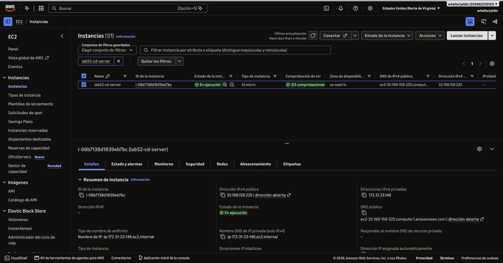

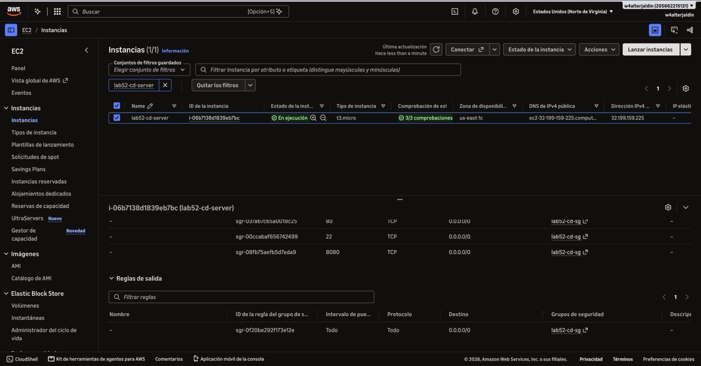

### 3.2 Un usuario y una llave SSH por entorno

Generé dos pares de llaves **ed25519** localmente:


| Entorno    | Usuario Linux  | Llave                    | Cómo se instaló                                     |
| ---------- | -------------- | ------------------------ | --------------------------------------------------- |
| production | `ubuntu`       | `production_ed25519`     | Importada en EC2 como *key pair* `lab52-production` |
| staging    | `stg-deployer` | `staging_deploy_ed25519` | Escrita en `authorized_keys` por el user data       |


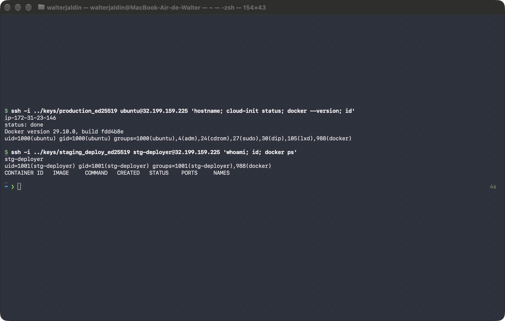

Así, aunque ambos entornos comparten servidor, **una llave filtrada de staging no da acceso como `ubuntu`, que tiene sudo**. `stg-deployer` solo pertenece al grupo `docker`.

### 3.3 Secretos, variables y GitHub Environments

**A nivel de repositorio** (compartidos por todo el pipeline):


| Tipo     | Nombre            | Valor                                                               |
| -------- | ----------------- | ------------------------------------------------------------------- |
| Secret   | `DOCKER_USERNAME` | Usuario de Docker Hub                                               |
| Secret   | `DOCKER_PASSWORD` | **Access Token** de Docker Hub (Read &amp; Write), no la contraseña |
| Variable | `IMAGE_NAME`      | `walterjaldin/cd-productos-api`                                     |


**A nivel de environment** (en **Settings &gt; Environments**):


|                           | `staging`                   | `production`                               |
| ------------------------- | --------------------------- | ------------------------------------------ |
| Secret `SSH_HOST`         | IP de la EC2                | IP de la EC2                               |
| Secret `SSH_USER`         | `stg-deployer`              | `ubuntu`                                   |
| Secret `SSH_PRIVATE_KEY`  | llave de staging            | llave de production                        |
| Variable `APP_PORT`       | `8080`                      | `80`                                       |
| Variable `CHECK_PORT`     | `9081`                      | `9080`                                     |
| Variable `CONTAINER_NAME` | `cd-api-staging`            | `cd-api-prod`                              |
| Variable `PUBLIC_HOST`    | DNS público de la EC2       | DNS público de la EC2                      |
| **Regla de protección**   | ninguna (deploy automático) | **Required reviewers** (aprobación manual) |


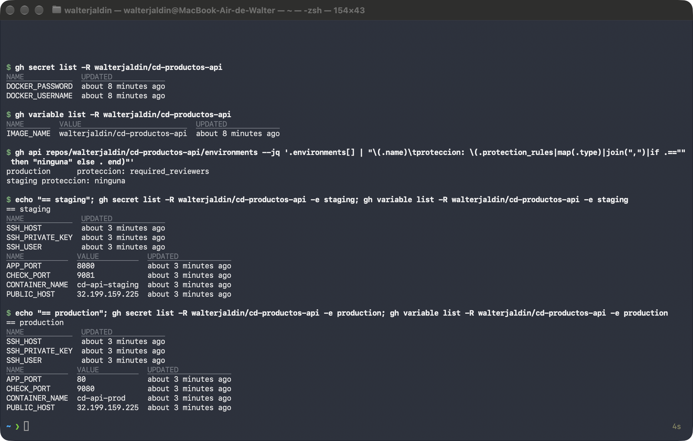

## 4. El workflow de CD (`.github/workflows/cd.yml`)

### 4.1 Disparadores

```yaml
on:
  push:
    branches: [main]
    tags: ['v*.*.*']
    paths-ignore: ['**.md', 'img/**']
  pull_request:
    branches: [main]
    paths-ignore: ['**.md', 'img/**']
```


| Evento                          | Qué hace                                                                    |
| ------------------------------- | --------------------------------------------------------------------------- |
| Push a `main`                   | Pipeline completo: CI → imagen → staging → production con aprobación        |
| Tag `v*.*.*`                    | Lo mismo, y además publica tags semánticos (`1.1.0`, `1.1`)                 |
| Pull request                    | CI, build y escaneo (Scout comenta en el PR); **no** hace push ni despliega |
| Cambios solo en `*.md` o `img/` | No dispara el pipeline                                                      |


### 4.2 Jobs


| Job                                   | `needs`          | Qué hace                                                                                         |
| ------------------------------------- | ---------------- | ------------------------------------------------------------------------------------------------ |
| `test` – Lint y pruebas               | –                | `npm ci`, `npm run lint`, `npm test`                                                             |
| `build-and-push` – Build, scan y push | `test`           | Buildx → build con `load: true` → **Docker Scout** → SARIF a GitHub Security → push a Docker Hub |
| `deploy-staging`                      | `build-and-push` | `environment: staging`; SSH con `appleboy/ssh-action` ejecuta `scripts/deploy.sh`                |
| `deploy-production`                   | `deploy-staging` | `environment: production`; **se pausa hasta que un revisor aprueba**                             |


Fragmento del job de build:

```yaml
- name: Generar tags y labels de la imagen
  id: meta
  uses: docker/metadata-action@v5
  with:
    images: ${{ env.IMAGE_NAME }}
    tags: |
      type=raw,value=${{ github.sha }}
      type=sha,prefix=sha-
      type=semver,pattern={{version}}
      type=semver,pattern={{major}}.{{minor}}
      type=raw,value=latest,enable={{is_default_branch}}
      type=ref,event=pr

- name: Build de la imagen (carga local para escanear)
  uses: docker/build-push-action@v6
  with:
    context: .
    load: true
    tags: ${{ env.IMAGE_NAME }}:${{ github.sha }}
    build-args: |
      APP_VERSION=${{ steps.ver.outputs.version }}
      GIT_SHA=${{ github.sha }}
    cache-from: type=gha
    cache-to: type=gha,mode=max

- name: Escaneo de vulnerabilidades (Docker Scout)
  uses: docker/scout-action@v1
  with:
    command: quickview,cves
    image: local://${{ env.IMAGE_NAME }}:${{ github.sha }}
    only-severities: critical,high
    only-fixed: true
    exit-code: false
    sarif-file: scout-report.sarif

- name: Push de la imagen a Docker Hub
  if: github.event_name != 'pull_request'
  uses: docker/build-push-action@v6
  with:
    push: true
    tags: ${{ steps.meta.outputs.tags }}
    cache-from: type=gha
```

Fragmento de un job de deploy. Los dos entornos usan el **mismo** job y el mismo script; lo que cambia son los secrets y variables del environment:

```yaml
deploy-production:
  needs: [build-and-push, deploy-staging]
  if: github.event_name == 'push'
  environment:
    name: production
    url: http://${{ vars.PUBLIC_HOST }}/health
  steps:
    - uses: actions/checkout@v6
    - uses: appleboy/ssh-action@v1.2.0
      env:
        IMAGE: ${{ vars.IMAGE_NAME }}:${{ github.sha }}
        CONTAINER: ${{ vars.CONTAINER_NAME }}
        PUBLIC_PORT: ${{ vars.APP_PORT }}
        CHECK_PORT: ${{ vars.CHECK_PORT }}
        APP_ENV: production
      with:
        host: ${{ secrets.SSH_HOST }}
        username: ${{ secrets.SSH_USER }}
        key: ${{ secrets.SSH_PRIVATE_KEY }}
        envs: IMAGE,CONTAINER,PUBLIC_PORT,CHECK_PORT,APP_ENV
        script_path: scripts/deploy.sh
```

- **Se despliega por SHA, no por `latest`.** `latest` cambia con cada push, *incluso cuando la imagen está rota* . Desplegar `IMAGE:${{ github.sha }}` garantiza que staging y production corren exactamente la imagen que se construyó y escaneó en ese run.
- **Se escanea antes de publicar.** La imagen se construye con `load: true`, se escanea en el runner y recién después se sube. El segundo `build-push-action` reutiliza la caché (`type=gha`), así que no reconstruye nada.
- **El script de deploy está en el repositorio** (`script_path`) y no embebido en el YAML. Así es versionable, reutilizable por el workflow de rollback y se puede probar a mano.
- **Docker Scout en lugar de `aquasecurity/trivy-action@master`.** La guía sugería cualquiera de los dos. En marzo de 2026 los tags de `trivy-action` fueron comprometidos en un ataque a la cadena de suministro, y `@master` apunta a una rama mutable. Elegí la acción oficial de Docker, que además ya usa la misma cuenta de Docker Hub.

### 4.3 Script de despliegue con health check (`scripts/deploy.sh`)

1. `docker pull` de la imagen por SHA.
2. Levanta la versión nueva en un **puerto de validación** (`CHECK_PORT`: 9081 en staging, 9080 en production). Ese puerto no está abierto en el security group.
3. **Health check con reintentos.** Hasta 10 intentos cada 3 s contra `/health`, en vez de un `sleep 5` fijo.
4. Si falla, elimina el contenedor de prueba y termina con `exit 1`. **El contenedor activo no se toca.**
5. Si pasa, guarda la imagen actual en `~/.<contenedor>.previous`, reemplaza el contenedor público y vuelve a verificar en el puerto público.
6. Si esa verificación final falla, hace un **rollback automático** a la imagen anterior.
7. `docker image prune -f` para no llenar el disco.

---

## 5. Escaneo de vulnerabilidades (Docker Scout)

### 5.1 Primer escaneo: v1.0.0

El primer escaneo de la imagen encontró **1 crítica y 15 altas** con corrección disponible, en 275 paquetes:


| Paquete                                                                 | Origen                               | C   | H   |
| ----------------------------------------------------------------------- | ------------------------------------ | --- | --- |
| `zlib 1.3.2-r1`                                                         | Alpine (SO base)                     | 1   | 0   |
| `openssl 3.5.9-r0`                                                      | Alpine (SO base)                     | 0   | 4   |
| `musl 1.2.6-r3`                                                         | Alpine (SO base)                     | 0   | 1   |
| `brace-expansion`, `pacote` (×2), `picomatch`, `ip-address`, `sigstore` | **npm incluido en la imagen `node`** | 0   | 10  |


**Ninguna** vulnerabilidad venía del código de la aplicación ni de sus dependencias (`express`). Todas vienen de la imagen base: del sistema operativo o de **npm**, que viene preinstalado en `node:22-alpine` pero no se usa en tiempo de ejecución.

### 5.2 Remediación: v1.1.0

Agregué al stage `runtime` dos cambios:

- `apk upgrade --no-cache`, que trae los parches de Alpine disponibles (corrige `zlib`).
- Eliminación de npm, npx, corepack y yarn de la imagen final.

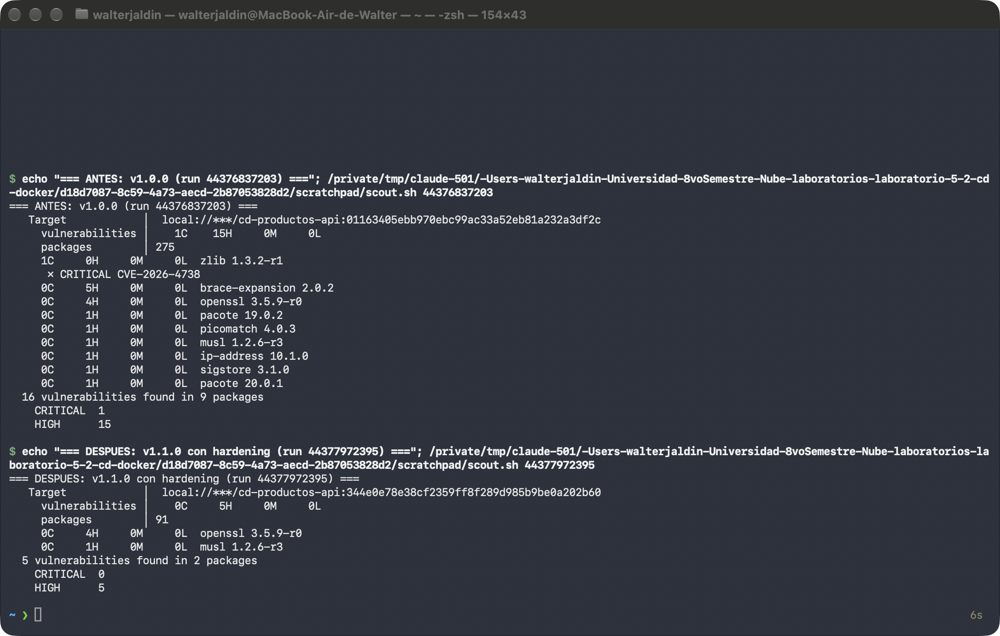


|                       | v1.0.0 | v1.1.0 |
| --------------------- | ------ | ------ |
| Críticas              | **1**  | **0**  |
| Altas                 | 15     | 5      |
| Paquetes en la imagen | 275    | 91     |


---

## 6. Ejecución del pipeline (fases en Actions)

### 6.1 Historial de ejecuciones

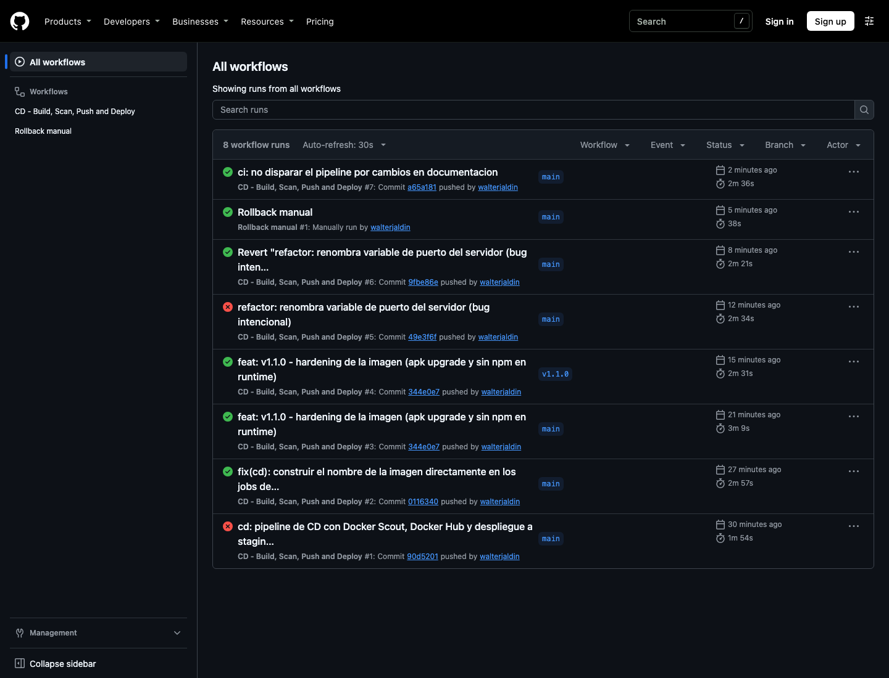


| #   | Commit             | Resultado | Qué demuestra                                                                                                                                                                                              |
| --- | ------------------ | --------- | ---------------------------------------------------------------------------------------------------------------------------------------------------------------------------------------------------------- |
| 1   | `90d5201`          | ❌         | Primer intento: `IMAGE` llegaba vacío al deploy (*invalid reference format*). Un `outputs` del job usaba `vars` y se resolvía vacío; lo corregí construyendo el nombre directamente en cada job de deploy. |
| 2   | `0116340`          | ✅         | Primer despliegue completo (v1.0.0) en staging y production                                                                                                                                                |
| 3   | `344e0e7`          | ✅         | v1.1.0 (hardening): cambio visible desplegado                                                                                                                                                              |
| 4   | tag `v1.1.0`       | ✅         | Release semántico: publica `1.1.0` y `1.1`                                                                                                                                                                 |
| 5   | `49e3f6f`          | ❌         | Simulación de fallo: el health check detiene el deploy                                                                                                                                                     |
| 6   | `9fbe86e`          | ✅         | Corrección con `git revert`                                                                                                                                                                                |
| –   | Rollback manual #1 | ✅         | Rollback de production a v1.0.0                                                                                                                                                                            |
| 7   | `a65a181`          | ✅         | Versión final                                                                                                                                                                                              |


### 6.2 Pipeline pausado esperando aprobación

Después de desplegar en staging, el job de production queda en **Waiting**: *"production requires an approval to start deploying changes"*.

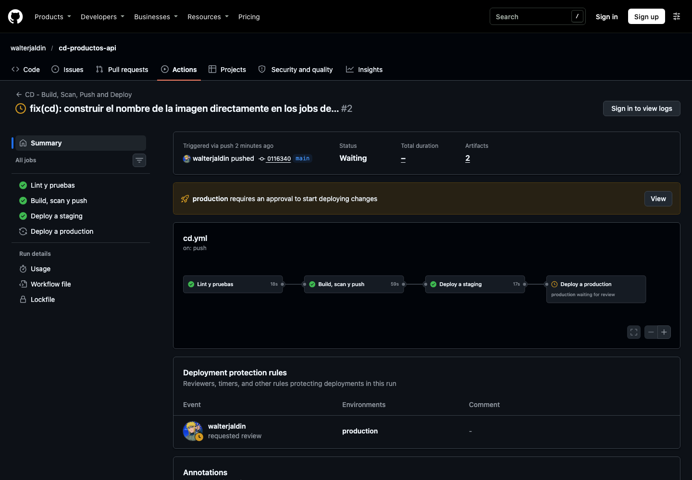

En ese momento staging ya tiene la versión nueva y production sigue con la anterior. Este fue el estado durante el despliegue de la v1.1.0:

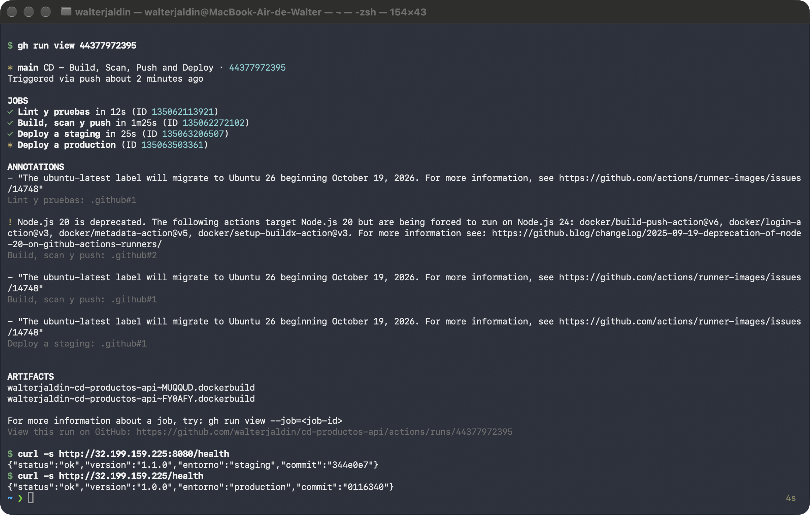

Se valida staging (`http://32.199.159.225:8080/health`) y luego un revisor aprueba. La aprobación y su comentario quedan registrados en el run (*Deployment protection rules*).

### 6.3 Pipeline completo

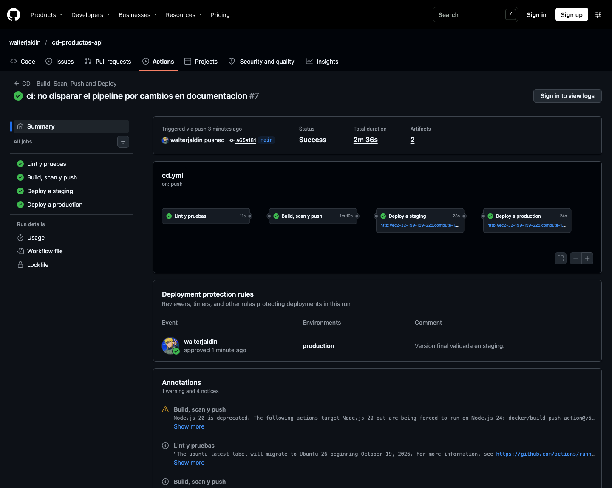

### 6.4 Logs del despliegue

Log del script en ambos entornos: pull de la imagen por SHA, health check exitoso en el puerto de validación, registro de la versión anterior, reemplazo y verificación final.

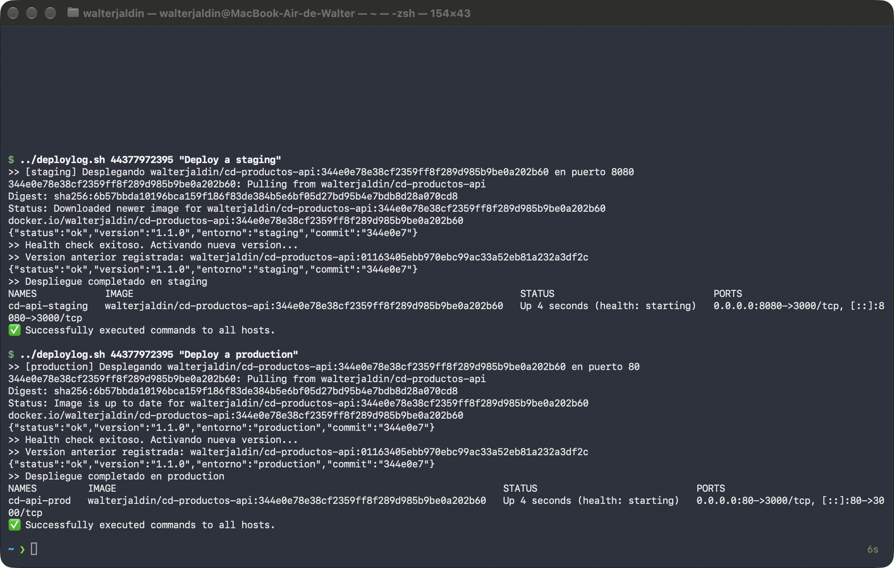

### 6.5 Imágenes publicadas en Docker Hub

Cada build publica varios tags que apuntan al **mismo digest**:


| Tag                            | Uso                                                                   |
| ------------------------------ | --------------------------------------------------------------------- |
| `01163405ebb9…` (SHA completo) | Lo que despliega el pipeline; inmutable y trazable al commit          |
| `sha-0116340`                  | Versión corta y legible del SHA, cómoda para rollbacks manuales       |
| `1.1.0`, `1.1`                 | Versionado semántico (solo cuando se publica un tag `v*.*.*`)         |
| `latest`                       | Último build de `main`, como referencia; **no** se usa para desplegar |


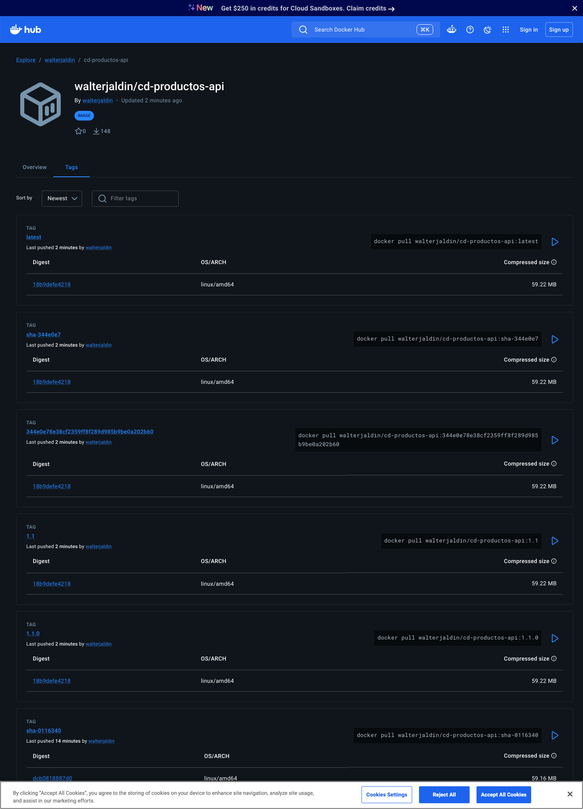

---

## 7. La aplicación funcionando en la instancia remota

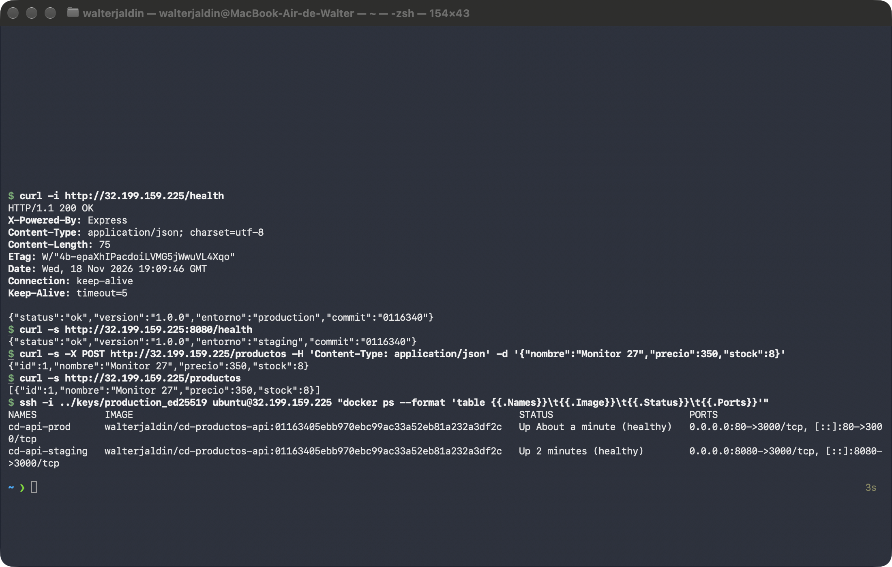

- `http://32.199.159.225/health` → **production** (puerto 80), con `HTTP/1.1 200 OK`.
- `http://32.199.159.225:8080/health` → **staging** (puerto 8080).
- El CRUD funciona en production (`POST` y `GET /productos`).
- En el servidor, `docker ps` muestra ambos contenedores **`(healthy)`** con la misma imagen por SHA.

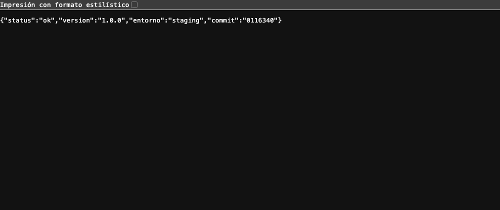

Estado final (commit `a65a181`, versión 1.1.0 en ambos entornos):

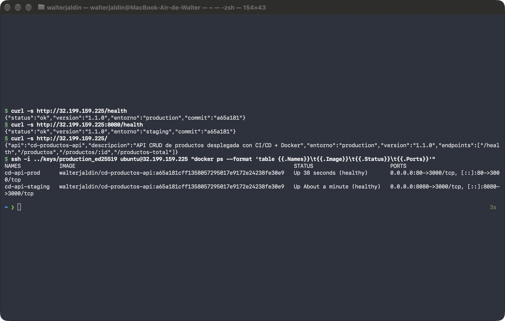

---

## 8. Simulación de fallo del health check (ejercicio 3.4.5)

Introduje un bug **que los tests no detectan**. En `src/server.js` cambié la variable del puerto:

```js
const PORT = process.env.SERVER_PORT || 4000; // BUG intencional: el contenedor expone 3000
```

Los tests usan `supertest` directamente sobre `app.js` y no arrancan `server.js`, así que el lint, las pruebas, el build y el escaneo **pasan**. La imagen incluso se publica en Docker Hub. El problema aparece solo cuando el contenedor corre de verdad: la app escucha en el 4000, pero el contenedor expone el 3000.

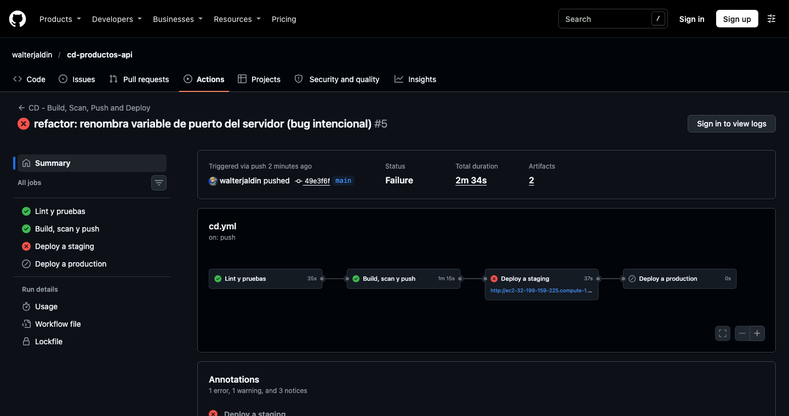

El script levantó la imagen nueva en el puerto de validación, hizo 10 intentos y canceló el despliegue:

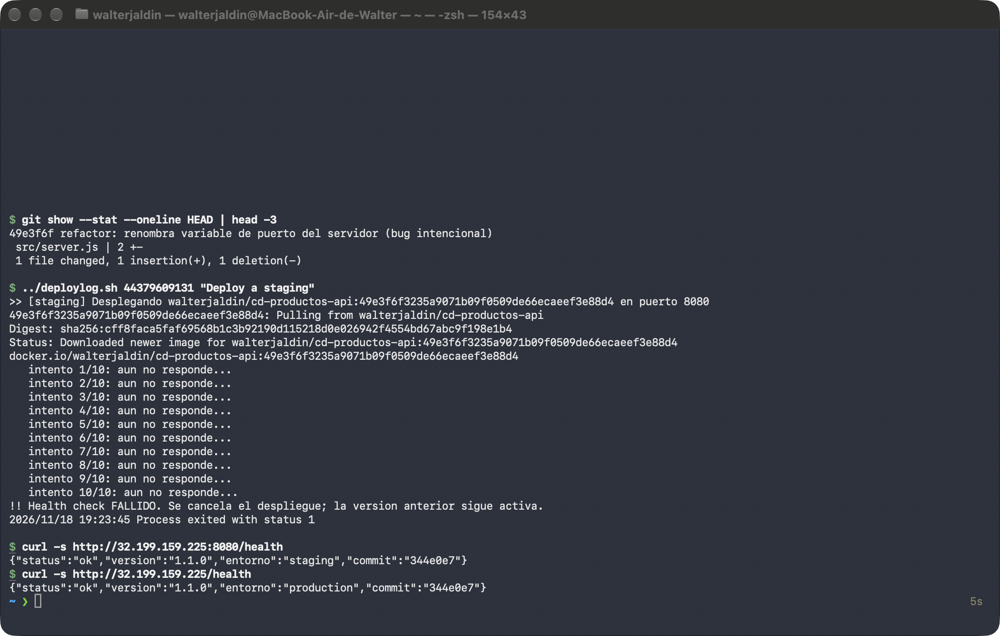

**Resultado:**

- `Deploy a staging` ❌. El contenedor de staging no se reemplazó y siguió sirviendo la v1.1.0 (`344e0e7`).
- `Deploy a production` se **omitió** (*skipped*) porque depende de staging. Production nunca estuvo en riesgo.
- Los usuarios no notaron nada: ambos entornos siguieron respondiendo `200 OK`.

Lo corregí con `git revert` (commit `9fbe86e`) y el pipeline siguiente volvió a desplegar sin problemas.

---

## 9. Rollback a una versión anterior

El health check evita desplegar una imagen que no arranca. Pero si se descubre un bug **después** de que la versión pasó el health check (por ejemplo, un cálculo incorrecto), hay que volver a una versión anterior. Como cada imagen está etiquetada con el SHA de su commit y con su versión semántica, en Docker Hub **siempre existen todas las versiones anteriores**. Un rollback es simplemente desplegar una imagen vieja.

Implementé y probé **tres** formas.

### 9.1 Rollback automatizado con el workflow `Rollback manual` (recomendado)

`.github/workflows/rollback.yml` se ejecuta con `workflow_dispatch`. Recibe dos entradas, el entorno (`staging` o `production`) y el tag de imagen, y reutiliza `scripts/deploy.sh`. Por lo tanto el rollback también pasa por el health check, y en production también requiere aprobación.

```bash
gh workflow run rollback.yml -f environment=production -f tag=01163405ebb970ebc99ac33a52eb81a232a3df2c
```

También se puede lanzar desde **Actions &gt; Rollback manual &gt; Run workflow**. Así revertí production de la v1.1.0 a la **v1.0.0**:

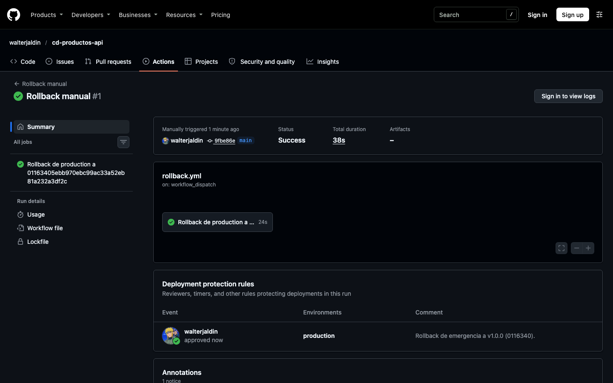

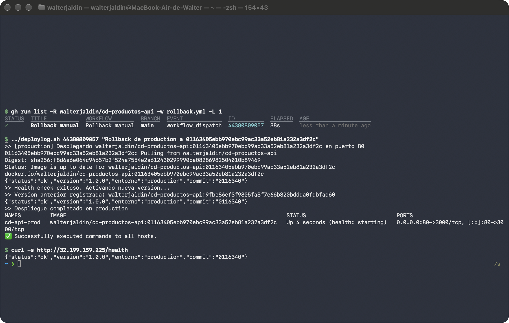

El rollback tomó **38 segundos** en total, incluida la aprobación. `/health` pasó a responder `"version":"1.0.0","commit":"0116340"`.

### 9.2 Rollback manual por SSH (método de la guía)

Si GitHub Actions no estuviera disponible, se hace directamente en el servidor. El script guarda en `~/.<contenedor>.previous` cuál era la imagen anterior, así que no hace falta buscar el SHA:

```bash
cat ~/.cd-api-staging.previous            # imagen anterior registrada por el deploy
docker pull walterjaldin/cd-productos-api:sha-0116340
docker stop cd-api-staging
docker rm cd-api-staging
docker run -d --name cd-api-staging --restart unless-stopped \
  -e APP_ENV=staging -p 8080:3000 walterjaldin/cd-productos-api:sha-0116340
```

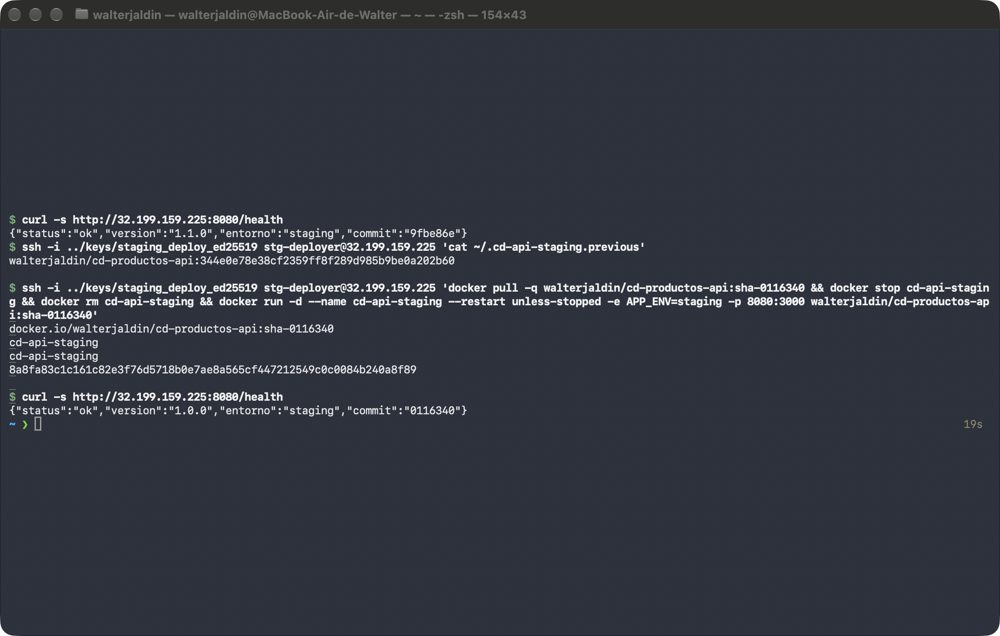

Staging pasó de `1.1.0 / 9fbe86e` a `1.0.0 / 0116340`. Para production, los comandos son los mismos con `cd-api-prod` y `-p 80:3000`.

### 9.3 Rollback automático dentro del deploy

Si la nueva versión pasa el health check en el puerto de validación pero **no responde en el puerto público** después del reemplazo, `deploy.sh` vuelve a levantar la imagen anterior sin intervención humana.


---

